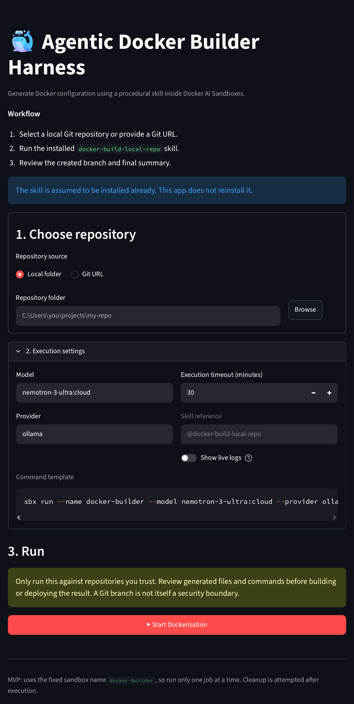

# 🐳 Agentic Docker Builder Harness


A small Streamlit harness that generates Docker configuration (a `Dockerfile`, `.dockerignore`, and related files) for a Git repository by running the OpenCode coding agent with a skill inside a Docker AI Sandbox. The model runs on Ollama Cloud. The harness handles the surrounding work: preparing the repository, launching and timing the agent, cleaning up the sandbox, and presenting the agent's report.

The harness is built around **agent skills**. A skill is a reusable set of instructions the agent follows for a specific job, and here it is the `docker-build-local-repo` skill that describes how to containerize a repository. Rather than leaving the model to improvise, the harness explicitly calls the model with that skill: the prompt names it with `@docker-build-local-repo`, so the model builds the Docker files by following the skill's procedure. That procedure goes well beyond writing a `Dockerfile`: the agent builds the image, runs the container to check that it actually works, scans for secret files, runs the project's tests if it has any, and only then finishes (see [What the skill does](#what-the-skill-does)).

You pick a repository, click a button, and the app runs the installed skill through the `sbx` CLI. When the run finishes, the app shows the agent's own report and some helpful Git notes.



## How it works

1. You choose a local Git repository, or give a Git URL and a clone destination.
2. The app runs this command from the repository folder. `sbx` starts a sandbox, runs the **opencode** agent in it, and uses the chosen model through the **Ollama** provider:

   ```bash
   sbx run --name docker-builder --model <model> --provider <provider> \
     opencode -- run "Build docker for this repo using @docker-build-local-repo"
   ```

   | Part | Role |
   |---|---|
   | `sbx run --name docker-builder` | Starts a Docker AI Sandbox with a fixed name |
   | `--model` / `--provider ollama` | The model and the provider that serves it (Ollama) |
   | `opencode -- run "..."` | The agent that runs inside the sandbox, using its `run` command with a prompt that explicitly calls the skill (`@docker-build-local-repo`) |

3. The agent's output is collected while it runs. You can optionally stream it live with the **Show live logs** toggle.
4. When the command ends (or times out), the app:
   - finds the last `Result:` line in the output and renders everything from there to the end as markdown,
   - compares Git branches before and after the run to show any branch the agent created,
   - removes the sandbox with `sbx rm docker-builder --force`.

The harness does not build the image, run tests, or verify any claim itself. The agent does the building and checking inside the sandbox, following the skill, and the harness displays what the agent reported along with Git facts it can check locally.

## What the skill does

The `docker-build-local-repo` skill (in the [agentic-skill](https://github.com/N-Harish/agentic-skill) repo) supports Node, Python, Go, Java, Rust, .NET, Ruby, PHP and static sites. Its core rule is that a successful build proves little: **the job is done only when the container has been started and probed.** The skill declares `docker`, `git` and `curl` as requirements. Everything below is done by the agent inside the sandbox, following the skill. The harness itself does not build, test or scan anything.

**Workflow**

1. **Preflight and safe branch.** It checks that the Docker daemon is reachable, then switches to a new branch (`docker/containerize-<date>-<time>` unless you name one) before creating or changing any file. It does not commit, push, merge or switch back. If the repo has no commits yet, it stops and asks you; if it isn't a Git repo, it warns that there is no safety net.
2. **Analyze cheaply.** One discovery command finds the stack, start command, port, env vars, external services and health path. It avoids reading lockfiles, tests and every route file, and writes down an assumption (for example port 8000 for FastAPI) where something is unknown, because the container run later catches a wrong guess.
3. **`.dockerignore` first.** It ignores every dot file and folder (`.git`, `.env*`, `.venv`, `.opencode` and so on), then re-includes only the dot files the build needs. It never re-includes `.env`, `.npmrc`, `.git` or credential files.
4. **Multi-stage Dockerfile.** Named stages (such as `deps`, `build`, `test`, `runtime`), a slim or distroless runtime, pinned base images, installs from lockfiles, cache mounts, a non-root numeric `USER`, exec-form `CMD`, binding to `0.0.0.0`, and a `HEALTHCHECK` where the image allows it. A separate `test` stage is added when the repo has tests.
5. **Build.** The image is built with a git-based tag (`name:<short-sha>`, with `-dirty` if there are uncommitted changes) plus `latest`. If the repo has tests, the `test` stage is run first, and a failing suite stops the workflow. Failed builds are retried up to 3 times.
6. **Verify (required).**
   - *Static checks:* the image runs as a non-root user, there are no secrets in the image history, and the exported filesystem has no `.git`, `.env`, private keys or similar files (public CA bundles are ignored).
   - *Run the container:* servers are started and probed on their health endpoint for up to 60 seconds. If the health route is static, it also calls a read-only database route to prove the app really works. CLIs are run with `--version` or `--help`, and workers are checked to stay running. Apps that need a database are tested with a temporary compose file kept outside the repo.
   - *Health and shutdown:* it checks the container's health status and times a graceful stop (a slow stop or exit 137 means SIGTERM was ignored).
   - *Multi-stage check:* build tools such as `gcc`, `go`, `npm` and `mvn` should not be present in the runtime image.
   - Failures are fixed and re-verified, up to 3 cycles, before reporting to you.
7. **Report, then exit.** It finishes with a `Result:` block containing the verdict (PASS, PASS with warnings or FAIL), branch, image tag and size, checks, files created, assumptions, and a `docker run` command it actually executed successfully. It offers to commit the files but does not do it unasked.

**Guardrails in the skill**

- Never works on your current branch.
- Never overwrites an existing `Dockerfile` or `.dockerignore`; it reviews and proposes changes instead.
- Never puts secrets in an image (`ENV`, `ARG`, `COPY .env`).
- No `--privileged`, no `docker.sock` mounts, no `docker system prune`, and no `docker push` unless asked. It removes only containers it created, labelled `skill=docker-build`.
- Does not edit application source or dependency files if a Dockerfile change can do the job. If an edit is unavoidable, it lists it prominently in the report.

The skill is the source of truth, so check its `SKILL.md` for the current steps.

## Requirements

**On the machine running the app:**

- [uv](https://docs.astral.sh/uv/), which also installs and manages Python 3.9 or newer for the project
- [Streamlit](https://streamlit.io/) 1.26 or newer (the app uses `st.toggle`); installed by uv
- [Git](https://git-scm.com/) on your `PATH`
- [Docker](https://docs.docker.com/get-docker/) installed and running
- [Docker Sandboxes (`sbx`)](https://docs.docker.com/ai/sandboxes/install/) installed, with `sbx` on your `PATH` and working from the same terminal you start Streamlit from
- [Ollama](https://ollama.com/) installed locally and signed in to Ollama Cloud, because `sbx` uses it as the model provider (`--provider ollama`) and the default model (`nemotron-3-ultra:cloud`) runs in the cloud, not on your machine. Make sure the model you choose is available to your account.
- The `docker-build-local-repo` skill installed in `sbx` (see [Install the skill](#install-the-skill)); this app does not install it for you
- Tkinter for the optional **Browse** button. It is part of Python's standard library and is already included with Python on Windows, so there is nothing to `pip install`. On some Linux distributions it is a separate package (see [Troubleshooting](#troubleshooting)).

## Installation

This project uses [uv](https://docs.astral.sh/uv/) to manage Python and dependencies. Install uv first if you don't have it (see the [uv installation guide](https://docs.astral.sh/uv/getting-started/installation/)).

```bash
git clone <this-repo-url>
cd <this-repo>
uv sync
```

`uv sync` creates the virtual environment and installs the dependencies from `pyproject.toml` and `uv.lock`. If Streamlit is not listed there yet, add it with:

```bash
uv add streamlit
```

### Install the skill

The agent needs the `docker-build-local-repo` skill, which is not installed by this app. Install it once with `sbx`:

```bash
sbx skills add https://github.com/N-Harish/agentic-skill
```

## Usage

```bash
uv run streamlit run app.py
```

Then in the browser:

1. **Choose repository**
   - *Local folder*: type a path or click **Browse**. The folder must contain a `.git` directory.
   - *Git URL*: enter the URL, a clone destination (must be new or empty), and optionally a branch or tag.
2. **Execution settings**
   - Set the model, provider, and timeout (1 to 180 minutes).
   - Turn on **Show live logs** to see the agent's output while it runs.
3. Click **▶ Start Dockerization** and wait for the report.

## Settings

| Setting | Default | Notes |
|---|---|---|
| Model | `nemotron-3-ultra:cloud` | Passed to `sbx run --model` |
| Provider | `ollama` | Passed to `sbx run --provider` |
| Execution timeout | 30 minutes | The sandbox command is stopped when this is reached |
| Show live logs | Off | Shows the last 200 lines of output while running; change `LOG_TAIL_LINES` in `app.py` to adjust |

The prompt, sandbox name, and skill reference are constants at the top of `app.py` (`SKILL_PROMPT`, `SANDBOX_NAME`).

## The report

After a run, the **Report** section shows the agent's output starting from its last `Result:` line. The app does not parse or rewrite it, so what you see is what the model wrote. For best results, the skill should end its output with a block that begins with `Result:` (for example `Result: PASS`) followed by branch, image, checks, files, assumptions, and run details.

If no `Result:` line is found, the app shows a warning and the last 60 lines of raw output instead.

Below the report you will also find:

- **Git working-tree notes**: the branch created during the run (from Git's own branch list) and the current branch.
- **Optional: commit the generated files** and **discard the work** command examples.
- **Check for images left by earlier attempts**: a reminder to inspect leftover Docker images.
- **Full raw agent output** and **Branch verification details** for debugging.

## Project structure

```
.
├── app.py                # The whole app: Git helpers, sandbox runner, Streamlit UI
├── pyproject.toml        # Project and dependency definition (uv)
├── uv.lock               # Locked dependency versions (uv)
├── .python-version       # Python version
├── .gitignore
├── imgs/
│   └── streamlit_ui.jpg  # App screenshot used in this README
└── README.md
```

## Tested on

The harness was tested on Windows against [`N-Harish/dummy_fastapi_app`](https://github.com/N-Harish/dummy_fastapi_app), a layered FastAPI e-commerce app with routers, services, repositories, models, schemas, a SQLite database, a `uv`-managed environment, and a pytest suite. This shows it can handle a repository with real structure rather than a single-file demo.

- **Agent:** opencode, run by `sbx`
- **Model:** `nemotron-3-ultra:cloud`, run on Ollama Cloud

Repository layout (generated and cache files such as `.venv`, `__pycache__` and `.pytest_cache` left out):

```
dummy_fastapi_app/
├── .gitignore
├── .python-version
├── README.md
├── pyproject.toml
├── pytest.ini
├── requirements.txt
├── run.sh
├── seed.py
├── uv.lock
├── app/
│   ├── __init__.py
│   ├── main.py
│   ├── api/
│   │   ├── __init__.py
│   │   └── v1/
│   │       ├── __init__.py
│   │       ├── router.py
│   │       └── endpoints/
│   │           ├── __init__.py
│   │           ├── admin.py
│   │           ├── health.py
│   │           └── store.py
│   ├── core/
│   │   ├── __init__.py
│   │   ├── config.py
│   │   └── database.py
│   ├── models/
│   │   ├── __init__.py
│   │   ├── order.py
│   │   └── product.py
│   ├── repositories/
│   │   ├── __init__.py
│   │   ├── order_repo.py
│   │   └── product_repo.py
│   ├── schemas/
│   │   ├── __init__.py
│   │   ├── order.py
│   │   └── product.py
│   └── services/
│       ├── __init__.py
│       └── order_service.py
└── tests/
    ├── conftest.py
    ├── test_admin.py
    └── test_store.py
```

In that run the agent reported `Result: PASS` on a new branch (nothing committed), created a `Dockerfile` and `.dockerignore`, and built a multi-stage image (builder, test, runtime) of about 230 MB. It also reported 10 passing tests, a non-root user, a passing health check, and a clean graceful stop. These are the agent's own results, as the app does not verify them. It also noted that the database lives at `/data/ecommerce.db`, so a volume mount is needed to keep data.

## Limitations

- **One job at a time.** The sandbox name is fixed (`docker-builder`), so running two jobs together will clash.
- **Folder picker is local only.** The Browse button opens a native dialog on the machine running Streamlit. If the app is hosted remotely, type the path instead.
- **Progress is approximate.** The progress bar reflects elapsed time against the timeout, not real task progress.
- **Nothing is independently verified.** Test results, image sizes, and security checks in the report come from the agent.

## Security

### How the harness reduces risk

- **Sandboxed execution.** The agent runs inside a Docker AI Sandbox started by `sbx`, so the repository's code is not run directly on your machine. Building the Docker image and running the tests happen inside that sandbox, which helps avoid executing untrusted code on your host.
- **Separate branch.** The work is done on its own branch (for example `docker/containerize-<timestamp>`) rather than on your main or production branch. The skill creates the branch and builds the Docker files there. The harness then compares the branch list before and after the run and shows you the branch it finds in Git, so you can check it independently of what the agent says.
- **Cleanup.** After every run the sandbox is removed with `sbx rm docker-builder --force`.

### Things to keep in mind

- Only run this against repositories you trust. The agent runs commands based on repository contents.
- With a cloud model such as `nemotron-3-ultra:cloud`, the prompts and the repository content the agent reads are sent to Ollama Cloud for inference. Do not use it on private or sensitive code unless you are comfortable with Ollama's data handling terms. For fully local inference, choose a model that runs on your own machine.
- Review the generated files and the changes in `git status` before building, committing, or deploying.
- A Git branch protects your main branch from direct changes, but it is not a security boundary. Uncommitted files are not tied to a branch and stay in your working tree when you switch branches.
- Check `git status` before running any discard commands.

## Troubleshooting

**The agent does not know `@docker-build-local-repo`**
The skill is probably not installed. Run `sbx skills add https://github.com/N-Harish/agentic-skill` and try again.

**`sbx` was not found on PATH**
Start the app with `uv run streamlit run app.py` from the terminal where `sbx` already works.

**Browse button shows "Folder picker unavailable"**
Tkinter may be missing from your Python. It ships with Python on Windows, but on Debian/Ubuntu you install it with `sudo apt install python3-tk`, and with Homebrew Python on macOS with `brew install python-tk`. You can always type the path manually.

**"The selected folder is not a Git repository"**
The folder must contain a `.git` directory. Run `git init` or select the repository root.

**"Clone destination must be a new or empty directory"**
Choose a path that does not exist yet or is an empty folder.

**Report says no `Result:` section was found**
The agent did not finish with a `Result:` line. Open **Full raw agent output**, or turn on **Show live logs**, to see what happened.

**Timeout reached**
Increase the timeout in Execution settings and try again.

**Sandbox cleanup warning**
Remove the sandbox by hand: `sbx rm docker-builder --force`.

## Topics

`agentic-ai` `ai-agents` `agent-skills` `docker` `docker-sandboxes` `dockerfile` `streamlit` `ollama` `opencode` `llm` `devtools` `python` `uv`